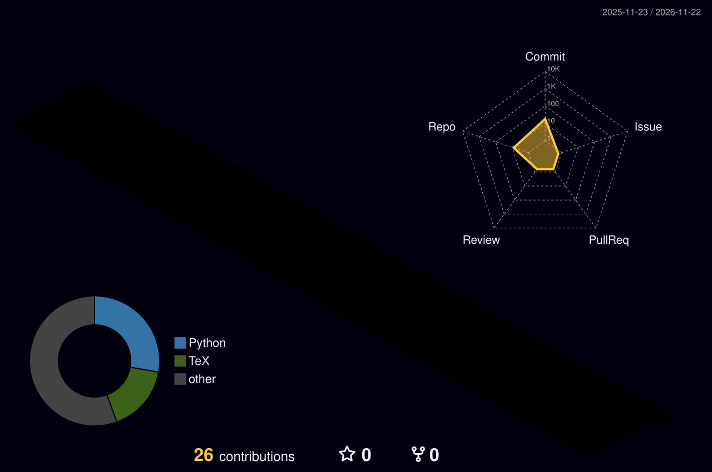

### Olá! 👋

- 👨‍💻 Sou o Vinícius, formando em Sistemas de Informação pela UFV – Campus Rio Paranaíba (2027)
- 💼 Hoje trabalho com prospecção B2B, onde criei automações em Python e Node.js para o time comercial
- 🎯 Procuro uma vaga de estágio ou júnior como desenvolvedor
- 🔎 Estudando agora: Threat Intelligence, unindo o que já uso no dia a dia (Python, automação e coleta de dados) à segurança da informação
- 📫 empviniciusmatoso@gmail.com

## Contato

| | |
|:-:|:-:|
|  |  |

